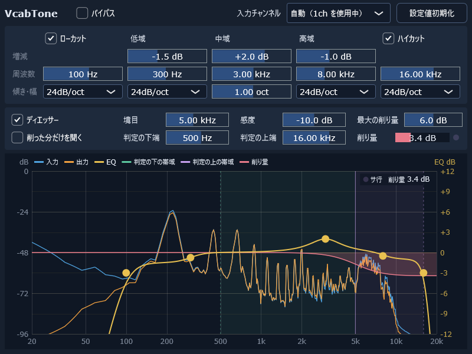

# VcabTone



声のための、つまみの少ない EQ と、声の大きさに左右されないディエッサーを 1 つにまとめたプラグインです。遅延は 0 です（先読みをしません）。

ボイスチェンジャー（[VcabShift](https://github.com/xelloss120/VcabShift) など）の後ろ、コンプ・リミッター・ゲートの前に置く想定です。

| 項目 | 内容 |
|---|---|
| 形式 | VST3 プラグインと、単体で動く EXE 版 |
| 対応 | Windows（64bit） |
| 遅延 | 0 |
| 負荷 | CPU 1 コアの約 0.2%（48kHz。音の処理だけ） |

## できること

| 機能 | 内容 |
|---|---|
| ローカット | 20〜300Hz、6 / 12 / 24dB/oct（初期値 100Hz、24dB/oct）。オン/オフ |
| 低域 | 下のシェルフ。100Hz〜1kHz、±6dB、6 / 12 / 24dB/oct |
| 中域 | ピーク。1〜8kHz、±6dB、幅 0.3〜3 オクターブ |
| 高域 | 上のシェルフ。6〜14kHz、±6dB、6 / 12 / 24dB/oct |
| ハイカット | 10〜20kHz、6 / 12 / 24dB/oct（初期値 16kHz、24dB/oct）。オン/オフ |
| ディエッサー | サ行の強すぎる息の音を、その瞬間だけ、境目（初期値 5kHz）から上のシェルフで下げる。削る量の上限は 0〜12dB（初期値 6dB） |
| 削った分だけを聞く | ディエッサーが削った音だけを出す（何を削っているかを耳で確かめるため。設定には保存しない） |
| 画面 | 入力と出力のスペクトルに、EQ の特性の曲線、ディエッサーが見ている帯域、いま削っている量を重ねて出す。EQ の点はドラッグで動かせる |

### ディエッサーの判定

約 1ms ごとに、境目より上の帯域（〜判定の上端）と下の帯域（判定の下端〜）の強さを測り、2 段で決めます。

1. **削るかどうか**: その瞬間、上の帯域が下の帯域より 3dB 小さい所より強ければ、サ行らしいとみなします。母音では、上の帯域はずっと小さいので反応しません。
2. **どれだけ削るか**: 上の帯域を、直近の声の「下の帯域の平均」（母音らしい所だけで更新）と比べ、「感度」を超えた分に応じて削ります。

比で見るので、大きな声で、あ行まで削れることも、小さな声で、サ行に反応しないこともありません。判定は EQ の後の音で行います。

## 使うときの注意

**ヘッドフォンで使ってください。** スピーカーで鳴らすと、出た音をマイクが拾って、ハウリング（キーンという大きな音）が起きることがあります。EXE 版は、起動してすぐ音が出るように、入力の消音を初めからオフにしています。

EXE 版の初回は、「オーディオ設定」ボタン（左上の「オプション」の中と同じ画面）から、入力と出力のデバイスを選んでください。マイクの入力チャンネル（1ch / 2ch）は、初期値の「自動」で、音が来ているほうを選びます。

ボイスチェンジャーを通さない男性の地声に使うときは、ローカットを 80Hz 以下に下げてください（初期値の 100Hz は、ボイスチェンジャーで声を高くした後を想定しています）。

## EXE 版を初めて起動するとき

署名をしていないので、ダウンロードした EXE を初めて実行すると、Windows の「PC が保護されました」という青い画面が出ます。次のどちらかで実行できます。

- 「詳細情報」を押してから「実行」を押す
- 実行する前に、EXE（または ZIP）を右クリック → プロパティ → 下のほうの「許可する」にチェック → OK

## ビルド

必要なもの: Visual Studio 2022（C++ によるデスクトップ開発）、CMake 3.22 以上、Git

```
git clone https://github.com/xelloss120/VcabTone.git
cd VcabTone
git submodule update --init
cmake -S . -B build -G "Visual Studio 17 2022" -A x64
cmake --build build --config Release
```

- `C:\src` のような浅い場所に置いてください。深い場所だと、Windows のパスの長さの制限で、clone やサブモジュールの取得が失敗することがあります。
- サブモジュールは JUCE だけです。

できるもの:

| ファイル | 内容 |
|---|---|
| `build/VcabTone_artefacts/Release/VST3/VcabTone.vst3` | VST3 プラグイン（フォルダ。フォルダごとコピーして使う） |
| `build/VcabTone_artefacts/Release/Standalone/VcabTone.exe` | EXE 版 |
| `build/vcabtn_render_artefacts/Release/vcabtn_render.exe` | 開発用の WAV 処理ツール |
| `build/vcabtn_shot_artefacts/Release/vcabtn_shot.exe` | 開発用の画面の撮影ツール（WAV を流しながら、プラグインの画面を PNG に書き出す。この README の画像もこれで作った） |

## 開発用のツール

`vcabtn_render` は、WAV ファイルにプラグインと同じ処理をかけて書き出します。設定は `キー=値` で渡します（キーは `Source/Core/Params.cpp` の一覧）。

```
vcabtn_render in.wav out.wav mid_gain=2 deess_sensitivity=-15
vcabtn_render in.wav out.wav --trace trace.csv --listen
```

- `--trace`: ディエッサーの判定（約 1ms ごとの上の帯域、下の帯域、平均、雑音、目標の削り量）を CSV に書く
- `--listen`: 削った分だけを書き出す
- `--response`: EQ の特性を CSV に書く
- `--set-at 秒 キー=値`: 途中から設定を変える

`Tools/Icon/make_icon.py` は、アイコンを作ります。

## ライセンス

Copyright (C) 2026 x120

[AGPLv3](LICENSE)（AGPL-3.0-only）。使っているライブラリ（JUCE など）のライセンスは [THIRD_PARTY_LICENSES.md](THIRD_PARTY_LICENSES.md) にまとめています。ASIO SDK を GPLv3 で使っているため、GPLv3 の本文を [LICENSES/GPL-3.0.txt](LICENSES/GPL-3.0.txt) に置いています。

アイコンの図柄は VoiChanAlgoBox のアイコン（同じ作者）を使っています。文字は Noto Sans Bold（SIL Open Font License）です。

VST is a trademark of Steinberg Media Technologies GmbH, registered in Europe and other countries.
